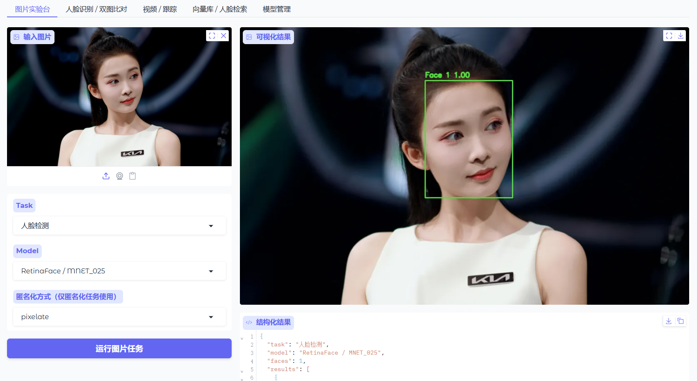

# UniFace Studio GUI

UniFace Studio 是基于 Gradio 的 UniFace 图形界面，覆盖 UniFace 4.0.0 提供的全部 15 类任务与模型变体。

| Task  | GUI 入口      | 支持内容                                                          |
| ----- | ----------- | ------------------------------------------------------------- |
| 人脸检测  | 图片实验台、视频    | RetinaFace、SCRFD、CenterFace、YOLOv5-Face、YOLOv8-Face、BlazeFace |
| 人脸识别  | 人脸识别 / 双图比对 | AdaFace、ArcFace、EdgeFace、MobileFace、SphereFace                |
| 人脸跟踪  | 视频 / 跟踪     | BYTETracker 持久化 Track ID                                      |
| 面部关键点 | 图片实验台       | 2d106det、PIPNet 98/68 点、Face Mesh 468/478 点                   |
| 人脸解析  | 图片实验台       | BiSeNet 19 类语义分割、XSeg 人脸掩码                                    |
| 人像抠图  | 图片实验台       | MODNet Photographic、Webcam                                    |
| 视线估计  | 图片实验台       | MobileGaze 全部模型变体                                             |
| 头部姿态  | 图片实验台       | HeadPose 全部模型变体，输出 pitch/yaw/roll                             |
| 人口属性  | 图片实验台       | AgeGender、FairFace                                            |
| 表情识别  | 图片实验台       | AffectNet-7、AffectNet-8                                       |
| 面部状态  | 图片实验台       | 眼睛、眼镜、墨镜、口罩概率                                                 |
| 人脸质量  | 图片实验台       | eDifFIQA T/S/M/L                                              |
| 活体检测  | 图片实验台       | MiniFASNet V1SE/V2                                            |
| 匿名化   | 图片实验台、视频    | Gaussian、Pixelate、Blackout、Elliptical、Median                  |
| 向量检索  | 向量库 / 人脸检索  | FAISS 注册、持久化和相似度检索                                            |

模型权重在首次使用时自动下载，并使用 SHA-256 校验。也可以在“模型管理”页面提前批量下载。



## 环境要求

- Python 3.10–3.14
- Windows、Linux 或 macOS
- CPU、Apple Silicon 或 NVIDIA CUDA
- 运行视频任务时建议系统已安装 FFmpeg，以获得更好的浏览器视频兼容性

## 安装

进入 UniFace Studio 工程目录：

```powershell
cd path\to\uniface_studio
```

CPU 环境：

```powershell
python -m pip install -e ".[cpu]"
```

NVIDIA CUDA 环境：

```powershell
python -m pip install -e ".[gpu]"
```

基础依赖包含 Gradio、FAISS 和表情模型需要的 PyTorch；`cpu` 或 `gpu` extra 用于选择 ONNX Runtime 版本。

## 启动

使用安装后的命令：

```powershell
uniface-studio
```

或使用 Python 模块：

```powershell
python -m uniface_gui
```

默认访问地址：

```text
http://127.0.0.1:7860
```

允许局域网设备访问：

```powershell
python -m uniface_gui --host 0.0.0.0 --port 7860
```

创建临时 Gradio 公网链接：

```powershell
python -m uniface_gui --share
```

公网链接会将界面暴露给外部访问者，不要在包含敏感照片或未受信任网络的环境中使用。

## 全局运行设置

页面顶部的“全局运行设置”控制多个工作区共用的推理配置。

### 推理设备

- `Auto`：由 ONNX Runtime 自动选择可用 provider。
- `CPU`：强制使用 `CPUExecutionProvider`。
- `CUDA`：优先使用 `CUDAExecutionProvider`，并以 CPU 作为后备。

选择 CUDA 前，需要安装 GPU 依赖，并确保 CUDA、cuDNN 和显卡驱动与 ONNX Runtime 兼容。

### 公共人脸检测器

识别、属性、质量、活体、关键点等任务会先使用公共检测器定位人脸。

BlazeFace 输出 MediaPipe 风格的 6 个关键点，不提供识别模型所需的标准 5 点对齐信息。因此，人脸识别和质量评估等任务应选择 RetinaFace、SCRFD、CenterFace 或 YOLO 检测器。

### 检测置信度

阈值越高，误检通常越少，但小脸、侧脸和模糊人脸也更容易被过滤。建议从 `0.5` 开始调整。

## 使用说明

### 图片实验台

1. 上传图片、粘贴剪贴板图片或使用摄像头拍照。
2. 选择 Task。
3. 选择该 Task 对应的 Model。
4. 点击“运行图片任务”。
5. 查看可视化图片和 JSON 结构化结果。

人像抠图不依赖人脸检测，会直接对整张图片计算 alpha matte。匿名化使用检测器定位所有人脸，再应用选定的模糊方法。

### 人脸识别 / 双图比对

1. 分别上传图片 A 和图片 B。
2. 选择识别模型。
3. 设置相似度阈值。
4. 点击“比较人脸”。

当前工作流使用每张图片中检测到的第一张人脸。结果包含余弦相似度、阈值和是否判定为同一人。

阈值需要根据实际数据、识别模型和误报要求进行标定，默认值仅用于演示。

### 视频 / 跟踪

支持以下操作：

- 人脸检测：逐帧绘制检测框和置信度。
- 人脸跟踪：通过 BYTETracker 为连续帧中的人脸分配 Track ID。
- 匿名化：逐帧检测并模糊人脸。

处理结果写入系统临时目录下的 `uniface_gui` 文件夹，并通过页面返回 MP4 文件。

长视频会占用较多处理时间和磁盘空间。建议先用短片段验证模型和阈值。

### 向量库 / 人脸检索

建立索引：

1. 上传一张或多张注册图片。
2. 在“身份标签”中按上传顺序每行填写一个身份名称。
3. 设置本地索引目录。
4. 选择识别模型。
5. 点击“建立 / 覆盖索引”。

例如上传三张图片时，标签输入应为：

```text
Alice
Bob
Charlie
```

执行检索：

1. 上传包含一张或多张人脸的查询图片。
2. 设置匹配阈值。
3. 点击“检索图片中的人脸”。

FAISS 索引和 JSON 元数据保存在配置的索引目录。重新建立索引会覆盖该目录中原有的索引内容。

### 模型管理

选择一个或多个模型后点击“下载并校验”。下载器会：

1. 优先从 GitHub Releases 下载。
2. 主地址不可用时尝试 Hugging Face 镜像。
3. 对下载结果执行 SHA-256 校验。
4. 将权重保存到 UniFace 模型缓存目录。

## 模型缓存

默认缓存路径：

```text
~/.uniface/models
```

可以通过 UniFace API 修改缓存路径：

```python
from uniface import set_cache_dir

set_cache_dir(r'path\to\models\uniface')
```

GUI 会缓存已初始化的模型实例。切换模型、provider 或检测阈值时，会为新配置创建对应实例。

## 命令行参数

```text
usage: python -m uniface_gui [-h] [--host HOST] [--port PORT] [--share]
```

| 参数        | 默认值         | 说明       |
| --------- | ----------- | -------- |
| `--host`  | `127.0.0.1` | 监听地址     |
| `--port`  | `7860`      | 监听端口     |
| `--share` | 关闭          | 创建临时公网链接 |

## 项目结构

```text
uniface_studio/
├── uniface/             # 上游 UniFace 完整源码
│   ├── uniface/         # UniFace Python 包
│   ├── tests/           # 上游测试
│   ├── docs/            # 上游文档
│   └── pyproject.toml   # 上游项目配置
├── uniface_gui/
│   ├── __init__.py      # 延迟加载的 Python API
│   ├── __main__.py      # python -m uniface_gui 入口
│   ├── app.py           # Gradio 页面及事件绑定
│   ├── engine.py        # 图片、视频、识别、FAISS 推理服务
│   └── registry.py      # Task、模型类和权重变体注册表
├── tests/
│   └── test_gui.py      # Studio GUI 测试
├── pyproject.toml       # Studio 安装、依赖和启动入口
└── README.md            # 本文档
```

## Python API

如果需要嵌入其他 Python 程序，可以直接构建 Gradio Blocks：

```python
from uniface_gui import build_app

app = build_app()
app.queue().launch(server_name='127.0.0.1', server_port=7860)
```

## 常见问题

### 首次推理很慢

首次使用会下载模型权重并初始化 ONNX Runtime 或 PyTorch。可以先在“模型管理”页面下载需要的模型。

### CUDA 选项无法运行

确认 Studio 安装时使用的是 `.[gpu]`，并检查：

```python
import onnxruntime as ort

print(ort.get_available_providers())
```

输出中应包含 `CUDAExecutionProvider`。

### 未检测到人脸

- 降低检测置信度。
- 换用 RetinaFace RESNET34/50 或 SCRFD 10G。
- 检查图片是否过暗、过小或侧脸角度过大。

### 视频可以处理但浏览器无法播放

OpenCV 输出的是 MP4V 视频。部分浏览器需要 H.264，安装 FFmpeg 后可将结果转换为 H.264：

```powershell
ffmpeg -i input.mp4 -c:v libx264 -pix_fmt yuv420p output_h264.mp4
```

### FAISS 无法导入

重新安装 GUI 依赖：

```powershell
python -m pip install -e ".[cpu]"
```

### 端口被占用

使用其他端口：

```powershell
python -m uniface_gui --port 7861
```

## 开发与验证

格式化和检查：

```powershell
python -m ruff format uniface_gui tests/test_gui.py
python -m ruff check uniface_gui tests/test_gui.py
```

运行 GUI 测试：

```powershell
python -m pytest tests/test_gui.py -q
```

运行完整项目测试：

```powershell
python -m pytest -q
python -m pytest -q uniface/tests
```

## 安全与隐私

- 人脸图片默认在运行 GUI 的本机完成推理。
- 使用 `--share` 会创建外部可访问链接，应避免处理敏感数据。
- FAISS 元数据可能包含身份名称和本地文件路径，应妥善保护索引目录。
- 人脸识别、人口属性和活体检测可能产生误判，不应作为高风险决策的唯一依据。

## 参考资料

- [UniFace 官方文档](https://yakhyo.github.io/uniface/)
- [UniFace Model Zoo](https://yakhyo.github.io/uniface/models/)
- [UniFace GitHub](https://github.com/yakhyo/uniface)
